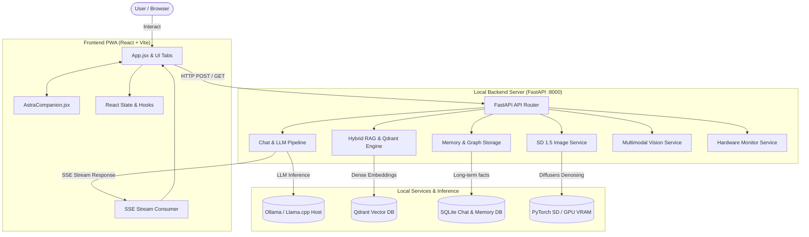
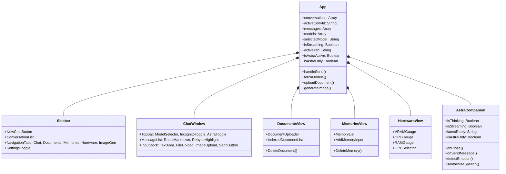
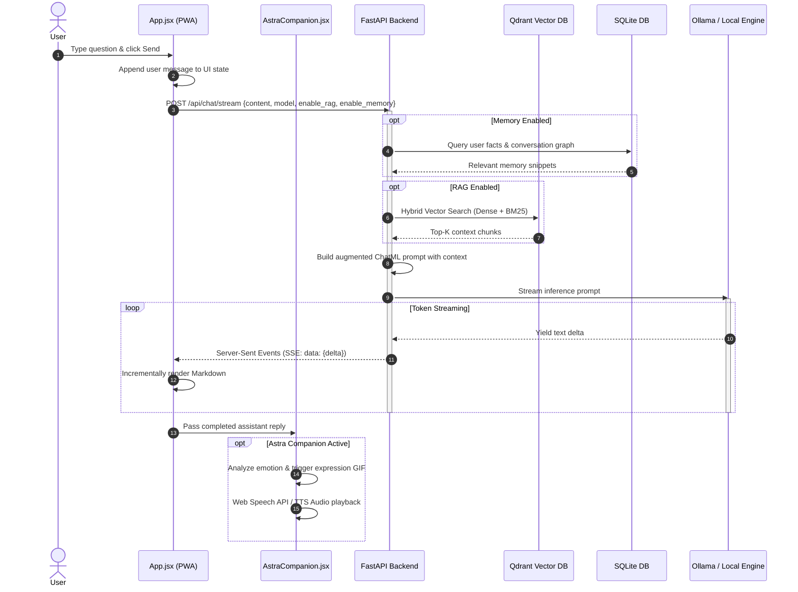
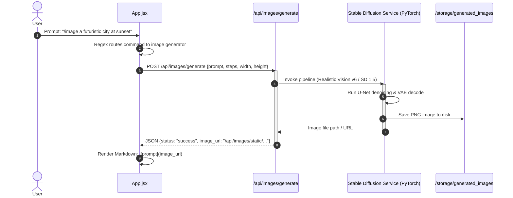
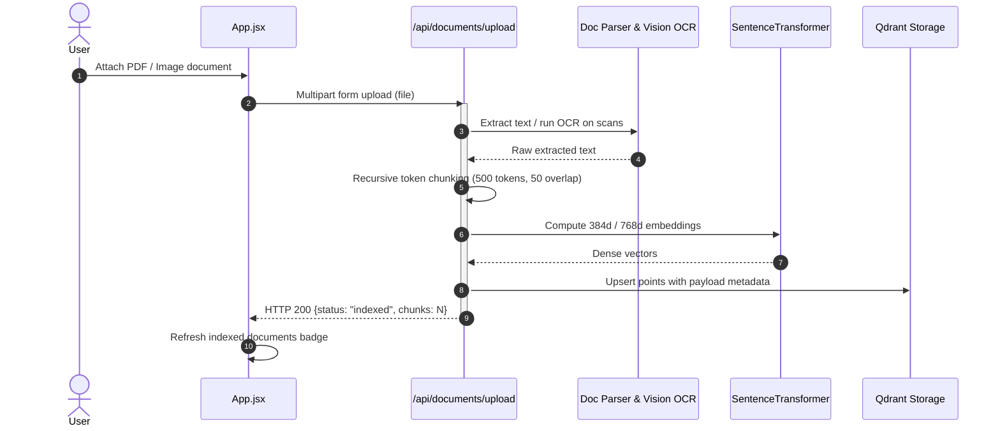

# AstraTalk PWA / Desktop Web Architecture & Flow

This document details the system architecture, component hierarchy, data flow, and interaction sequences for the **AstraTalk Progressive Web App (PWA) / Desktop Web application** located in `frontend/`.

---

## 1. High-Level Architecture Diagram

---

## 2. Component Hierarchy Diagram

---

## 3. Core Chat, RAG & Memory Execution Sequence

This sequence diagram depicts how a message is routed through memory retrieval, vector RAG search, LLM inference streaming, and companion TTS lip-sync.

---

## 4. In-Chat & Dedicated Image Generation Flow

---

## 5. Document Ingestion & Multimodal OCR Flow

