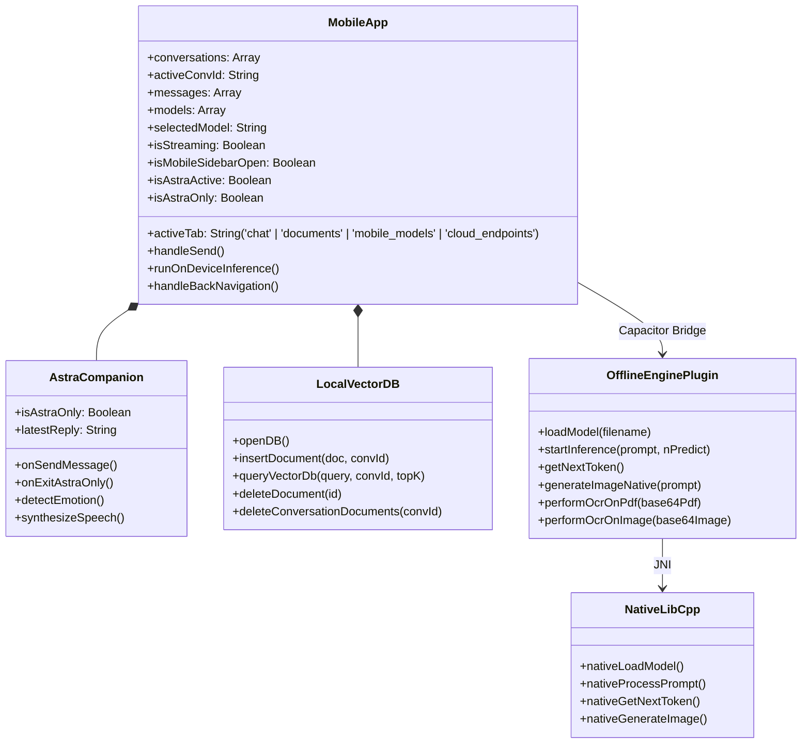
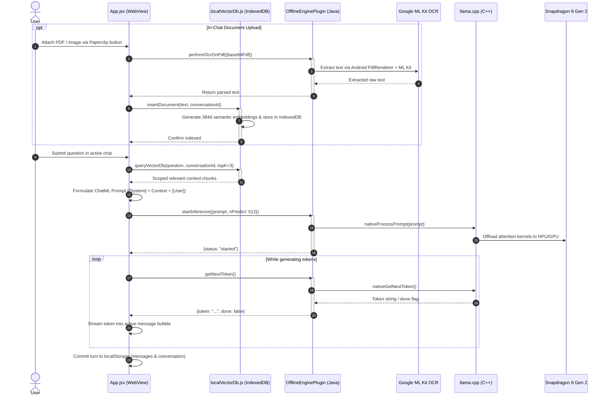
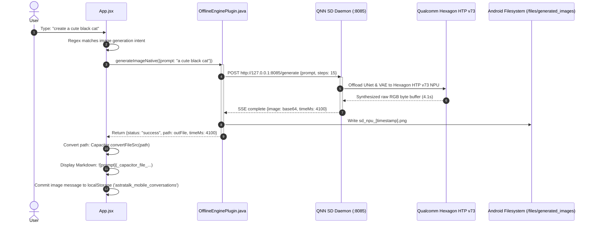
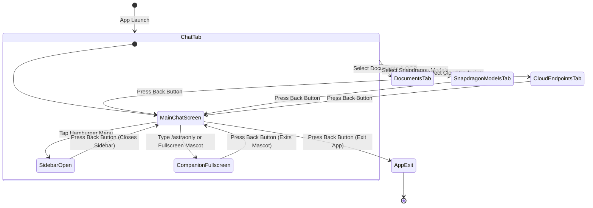

# AstraTalk Mobile Architecture & On-Device Flow

This document details the mobile system architecture, native bridge layers, hardware-accelerated on-device inference, vector database RAG, and navigation flows for the **AstraTalk Android App** located in `mobile/`.

---

## 1. High-Level Mobile Architecture Diagram

```mermaid
graph TD
    User([Android User])

    subgraph WebViewApp ["Capacitor WebView (React / web-src)"]
        MobileUI[App.jsx & Mobile Shell]
        Mascot[AstraCompanion.jsx]
        LocalVDB[Local Vector DB (localVectorDb.js / IndexedDB)]
        CapacitorCore[Capacitor Core Bridge]
    end

    subgraph NativePlugin ["Android Native Layer (OfflineEnginePlugin.java)"]
        PluginBridge[OfflineEnginePlugin Bridge]
        MLKit[Google ML Kit Text Recognition OCR]
        PdfRender[Android PdfRenderer Service]
        FileStore[Android Internal App Storage (/files)]
        DaemonManager[Qualcomm QNN Daemon Manager]
    end

    subgraph NativeInference ["On-Device Hardware AI Accelerators"]
        JNI[JNI llama.cpp native-lib.cpp]
        HexagonNPU[Qualcomm Hexagon HTP v73 NPU (SD Turbo / AnythingV5)]
        AdrenoGPU[Adreno 740 GPU / OpenCL CLBlast]
        KryoCPU[ARM Cortex-X3 / A715 CPU Multi-threading]
    end

    User -->|Touch & Gestures| MobileUI
    MobileUI <--> Mascot
    MobileUI <--> LocalVDB
    MobileUI -->|Capacitor Plugins API| CapacitorCore
    CapacitorCore <--> PluginBridge

    PluginBridge -->|Process PDF| PdfRender
    PdfRender -->|Bitmaps| MLKit
    PluginBridge -->|Process Image OCR| MLKit
    PluginBridge -->|HTTP :8085 / SSE| DaemonManager
    DaemonManager -->|HTP / QNN Direct| HexagonNPU

    PluginBridge -->|JNI Calls| JNI
    JNI -->|GPU Offload| AdrenoGPU
    JNI -->|Multi-threaded Kernels| KryoCPU
    HexagonNPU -->|Rendered PNG| FileStore
    FileStore -->|Capacitor.convertFileSrc| MobileUI
```

---

## 2. Component Hierarchy Diagram



---

## 3. On-Device Chat & Scoped RAG Sequence

This sequence diagram illustrates how document OCR and vector embeddings are stored per chat in IndexedDB, and subsequently retrieved to augment the local GGUF model via JNI.



---

## 4. On-Device Stable Diffusion Image Generation Flow



---

## 5. Android Back Button & View Navigation State Machine

This state diagram explains the interception and fallback routing when the Android system hardware or gesture back action occurs.



